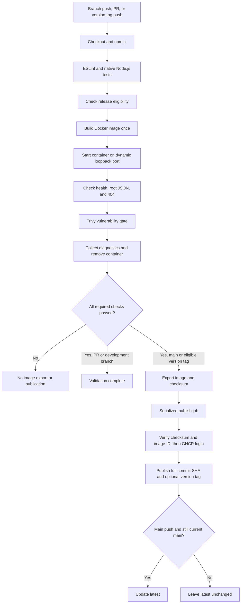

# DevOps Practicum

A small Node.js HTTP service for a university practicum using GitFlow, GitHub
Actions, Docker, and GitHub Container Registry (GHCR). AWS EC2 and Docker Swarm
are future deployment targets; this repository change does not provision them.

## Current progress

- Node.js 24 service, native `node:test` tests, and ESLint.
- Non-root Docker image with a runtime health check and OCI source metadata.
- CI validates the application, tests the actual container, and scans it with Trivy.
- A separate, least-privilege job publishes the exact tested image to the existing
  `ghcr.io/heisernbergg0942/devops-project` registry.
- AWS/Swarm deployment is not implemented by this pipeline.

These pipeline improvements are local until reviewed and integrated. The working
tree is based on `develop`; remote `main` already contains the working GHCR
pipeline and source-label fix. See the [repository audit](docs/repository-cleanup.md)
for the synchronization plan. No branches have been merged or deleted by this work.

## Repository structure

```text
.
├── .github/workflows/ci.yml    # Validation and serialized GHCR publication
├── docs/
│   ├── repository-cleanup.md  # Audit and safe branch synchronization plan
│   └── security-policy.md     # Vulnerability gate and dependency-pin policy
├── scripts/ci/
│   ├── check-latest.js        # Rejects stale latest promotions
│   ├── release-policy.js      # Validates main/release publication eligibility
│   └── smoke-test.js          # Checks container readiness and response bodies
├── src/server.js
├── test/                     # Native route, smoke, and publication-policy tests
├── .dockerignore             # Only package manifests and src/ enter the image
├── .editorconfig
├── .gitattributes
├── .gitignore
├── Dockerfile
├── eslint.config.cjs
├── package-lock.json
├── package.json
├── trivy.yaml
└── README.md
```

No empty infrastructure directories or generated artifacts are tracked.

## Local development

Requirements: Node.js 24.x, npm, and Docker Engine for container checks. On
Windows, use the WSL Linux project directory.

```bash
npm ci
npm run lint
npm test
npm start
```

The service listens on `0.0.0.0:3000`. Stop it with Ctrl+C. There are no runtime
dependencies, external services, or required environment variables. ESLint and
its configuration helpers are development-only dependencies locked by npm.

| Request | Expected response |
| --- | --- |
| `GET /` | Application name, package version, and deployment message |
| `GET /health` | `200`, `{"status":"healthy"}` |
| Unknown path | `404`, `{"error":"Not found"}` |

### Container checks

```bash
docker build --pull -t devops-demo:local .
docker run -d --name devops-demo-local -p 127.0.0.1:3000:3000 devops-demo:local
APP_URL=http://127.0.0.1:3000 npm run test:smoke
docker inspect --format '{{.State.Health.Status}}' devops-demo-local
docker logs devops-demo-local
docker rm -f devops-demo-local
```

Health initially may be `starting`. The Dockerfile retains Node.js 24 Alpine,
`npm ci --omit=dev`, the non-root node account (UID/GID `1000:1000`), and the
existing `org.opencontainers.image.source` label. Tests, lint tools, Git metadata,
docs, and local credential files are excluded from the runtime image.
After dependency installation, npm and its download cache are removed: this
service starts directly with `node` and does not need npm at runtime.

With Trivy `v0.76.2` installed locally, reproduce the CI vulnerability gate:

```bash
trivy image --config trivy.yaml --image-src docker devops-demo:local
```

## CI architecture



Diagnostics and cleanup use `always()` even if an earlier step fails; the diagram
shows the success path. Failures in required validation, scanning, or cleanup
prevent image export. Publication depends on the successful validation job.

### Triggers and safeguards

- Branch pushes: `main`, `develop`, `feature/**`, `release/**`, `hotfix/**`.
- Pull requests: targeting `main` or `develop`; never publish.
- Tag pushes: `v*.*.*`, followed by strict stable-SemVer and ancestry validation.
- `npm ci` uses committed integrity hashes; lint fails on warnings.
- Every action reference is pinned to an upstream-verified commit SHA. Trivy is
  pinned to `v0.76.2`; see the [security policy](docs/security-policy.md).
- Validation has a 20-minute timeout; smoke checks 2 minutes; Trivy 7 minutes
  (internal scan timeout 5 minutes); publishing 10 minutes.
- Bash uses `-euo pipefail`, quoted variables, and explicit image-identity checks.
- Container diagnostics and scan output are uploaded for 7 days, including on
  failure. Successful publishable images are artifacts for 1 day, with tar
  checksum and Docker image-ID verification after download.
- Image artifacts are attempt-specific, and the producing job passes their name
  to publishing so rerunning only a failed publish job still downloads the right image.
- Only the publishing job has `packages: write`; other jobs have `contents: read`.
  Checkout does not persist credentials. Publishing uses built-in `GITHUB_TOKEN`,
  not a personal access token.

### Concurrency and `latest`

New PR/feature/development runs cancel obsolete runs for the same ref. Main and
release-tag runs do not cancel an active run. All publication jobs share one
non-cancelling concurrency group across main and version tags.

GitHub concurrency is not FIFO and may replace pending jobs. Serialization alone
is therefore insufficient: immediately before pushing `latest`, the job reads
the current `main` SHA using GitHub's authenticated API. Only an exact match may
promote it; API failures fail closed. An older run can publish its own commit
tag, but cannot overwrite `latest` after a newer main commit is present. Version
tag runs never update `latest`.

### Image tags and releases

Registry: **`ghcr.io/heisernbergg0942/devops-project`** (unchanged).

| Trigger | Published tags |
| --- | --- |
| Successful current `main` push | Full commit SHA and `latest` |
| Successful stale `main` push | Full commit SHA only |
| Eligible `v1.0.0` tag push | Full commit SHA and `v1.0.0`; never `latest` |
| PR or other branch | None |

For a release, update `package.json` and the lockfile version through the normal
release PR, integrate the released commit into `main`, then create a tag such as
`v1.0.0` on that commit through the approved release process. The tag must match
the package version and its commit must be reachable from `main`. Invalid tags,
prereleases, and tags on unmerged development commits fail validation. Creating
or pushing a tag is not performed by this repository change.

Tag events run **all** required checks again. Each run builds once; neither
image export nor publication rebuilds the image. A tag workflow is a separate
validation run, not reuse of an older unscanned artifact. The base image and
vulnerability DB are updated over time, so reruns of the same source commit may
produce a different image and retag its SHA/version references. Use the published
**image digest** when an immutable deployment reference is needed; do not rely on
`latest` or assume a source-SHA tag is an immutable binary.

### Vulnerability policy

Trivy scans OS and application packages in the tested local image. Any **HIGH or
CRITICAL** finding blocks CI and publication, **including unfixed vulnerabilities**.
Scanner errors, missing databases, and timeouts also block publication. Lower
severities are not blocking. No blanket ignores or `continue-on-error` are used.
See [security policy and remediation](docs/security-policy.md).

### Caching decision

The existing npm download cache is retained now that lint tooling adds actual
dependencies; `npm ci` still recreates the install from the lockfile. No remote
Docker build cache is added: this tiny service has no compile step or production
dependencies, so cache setup/transfer is unlikely to repay its complexity. Trivy
downloads a fresh DB rather than restoring a potentially stale cached database.
Reassess Docker caching only after measuring significant build time growth.

### Local validation

All 15 native tests, ESLint, workflow `actionlint`, Dockerfile `hadolint`, Docker
build checks, container smoke/health checks, and image export/load verification
passed locally. The final Trivy scan reported **zero HIGH/CRITICAL findings**
after install-only npm tooling was removed. GitHub-hosted artifact transfer and
actual registry publication still need verification through the reviewed CI run;
this work did not push an image or change repository settings.

## GitFlow and repository hygiene

- `main`: stable released history; protect it with required checks and PR review.
- `develop`: integration branch; keep it synchronized with released fixes.
- `feature/<description>`: work from `develop`.
- `release/<version>`: release preparation; integrate into `main` and `develop`.
- `hotfix/<description>`: urgent work from `main`; integrate back into `develop`.

Protect release-tag creation with a GitHub ruleset and restrict publishing workflow
changes to reviewed code. Package Actions access must grant this repository Write
access to the existing GHCR package; making the package public is not required.

Do not reset shared branches, force-push, or delete unmerged work. The
[repository audit](docs/repository-cleanup.md) records the current branch gap and
safe synchronization/retirement recommendations. Ignore files keep dependency
directories, logs, reports, image exports, and local credentials out of Git;
they do not replace secret review.
